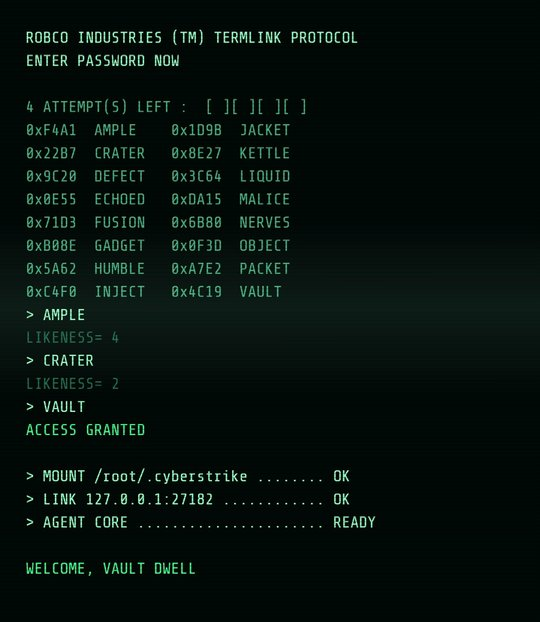
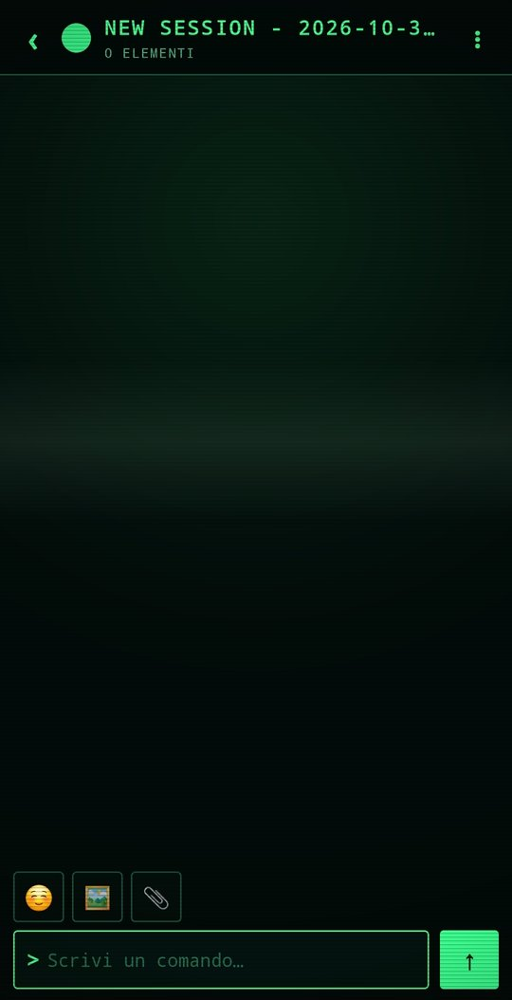

# CyberStrike Android Client

**English** · [Italiano](README.it.md)

> **Status: 0.3.0 — in use on a real device.**
> Native client for the [CyberStrike](https://cyberstrike.io) server: sessions,
> SSE streaming chat, permissions, agent questions and a PTY terminal.
> Something wrong? `⋮ → Diagnostics → Copy` and paste the report.

APK **~460 KB**, no Gradle and no AndroidX: one Java module built by hand with
`aapt2` + `javac` + `d8`, packaged and signed with `apksigner`.

The UI is **PIP-BOY** style: green phosphor on a cathode-ray tube, CRT
scanlines, monospace type and — in the background — *I Don't Want To Set The
World On Fire* played from the phone's audio files.





```
┌────────────────────────────────┐
│  CyberStrike app (Java)        │
│  ├─ Sessions (ListView)        │
│  ├─ Chat + SSE streaming       │
│  ├─ Permissions / Questions    │
│  └─ Terminal (PTY)             │
└───────────────┬────────────────┘
                │ HTTP + SSE  →  127.0.0.1:27182
┌───────────────▼────────────────┐
│  Termux                        │
│   └─ ~/.cs-supervisor.sh       │   single proot, in-place restarts
│        └─ proot Debian         │
│             └─ cyberstrike     │   serve --port 27182 --hostname 127.0.0.1
└────────────────────────────────┘
```

## Features

| Feature | Endpoint |
|---|---|
| List / create / delete sessions | `GET/POST/DELETE /session` |
| Message history | `GET /session/{id}/message` |
| Send a prompt (blocking call, output streamed over SSE) | `POST /session/{id}/message` |
| Live stream of text, reasoning and tool calls | `GET /event` |
| Approve tool permissions | `GET /permission`, `POST /permission/{id}/reply` |
| Answer agent questions | `GET /question`, `POST /question/{id}/reply` |
| Abort | `POST /session/{id}/abort` |
| Models and agents | `GET /config/providers`, `GET /agent` |
| Terminal | `POST /pty` + WebSocket `/pty/{id}/connect` |

## Graphics

- **Phosphor palette**: background `#020A08`, text `#93FFC6`, accent `#3CFF8F`,
  error `#FF6A3D`. Square corners (2-3 dp), panels with an accent bar.
- **`ui/CrtOverlay`**: horizontal scanlines, vignette and a bright band slowly
  travelling down. Used on sessions, chat, models and terminal; it never
  intercepts touches.
- **`ui/BootScreen`** (intro, ~5 s, tap to skip): the
  `ROBCO INDUSTRIES (TM) TERMLINK PROTOCOL` header, a grid of 16 hexadecimal
  passwords, three attempts with `LIKENESS=`, `ACCESS GRANTED` and finally the
  CyberStrike OS boot lines.
- **Font**: *Share Tech Mono* (SIL OFL 1.1) in `assets/fonts/pip.ttf`, applied
  to every activity by `CsApp`; views tagged `nofont` (emoji) keep the system
  font.
- **Icons**: launcher and adaptive foreground drawn as a circular gauge with
  ticks and a needle.

## Audio

`util/Ambient.java` looks for the track among the device audio files:
`MediaStore` with `DISPLAY_NAME LIKE '%set the world%'` and `SIZE > 100 KB`,
otherwise it scans `Download/`. It loops at volume 0.5, pauses when the app goes
to the background (activities are counted in `CsApp`) and honours audio focus.

The track is **not bundled in the APK** (it is copyrighted): it is read from the
local file. It needs the audio read permission — `READ_MEDIA_AUDIO` on Android
13+, `READ_EXTERNAL_STORAGE` up to Android 12 — requested once, ~3 s after the
intro. On/off in `⋮ → Music: ON/OFF`.

## Requirements

1. **Termux** — the app downloads it from GitHub Releases and opens the
   installer (you must allow unknown sources for CyberStrike).
   Alternatively: [GitHub Releases](https://github.com/termux/termux-app/releases), `arm64-v8a` APK.
   Avoid the Play Store build: it is outdated and does not work with proot-distro.
2. In Termux, allow execution from other apps:

   ```bash
   echo 'allow-external-apps = true' >> ~/.termux/termux.properties
   termux-reload-settings
   ```

3. ~600 MB of free space for Debian + CyberStrike.

## Installation

Download the APK from the latest [Release](../../releases) and install it
(you must allow installation from unknown sources).

On first launch the app:

1. checks whether the server answers on `127.0.0.1:27182`;
2. if not, runs `assets/bootstrap.sh` inside Termux:
   - installs `proot-distro` and Debian if missing;
   - installs `curl`/`tar` inside the container;
   - downloads CyberStrike if `~/.cyberstrike/bin/cyberstrike` is missing;
   - generates the server password in `~/.cs-server-password`;
   - writes and starts the `~/.cs-supervisor.sh` supervisor;
3. waits for the port to answer (up to 30 minutes on the first run).

The setup log is `~/.cyberstrike-setup.log`, the server log is
`~/.cyberstrike-server.log` (inside Termux). The `~/.cs-setup.done` sentinel
means installation already happened: on later launches the bootstrap skips
installs and checks.

### Supervisor and restarts

The server runs inside **one** `proot`, managed by `~/.cs-supervisor.sh`:

```bash
while true; do cyberstrike serve --port 27182 --hostname 127.0.0.1; sleep 5; done
```

The loop lives *inside* the container: if the server dies it is restarted
without spawning new `proot` processes. This is the countermeasure to the
Android 12+ *phantom process killer*, which kills Termux (SIGKILL) when child
processes pile up. If the crash is immediate, the supervisor backs off from 5 s
to 180 s.

### Port

The app defaults to **27182** (not 4096, which is CyberStrike's default and is
often taken by an instance started by hand). Change it in
`⋮ → Settings → Server URL`; the bootstrap starts the server on the port from
the configured URL.

## Configuration

`⋮` → **Settings**:

- **Server URL** — default `http://127.0.0.1:27182`. It may point to a remote server.
- **Token** — sent as `Authorization: Bearer …` if the server requires it.
- **Agent** — default `cyberstrike`.
- **Model** — provider/model from `/config/providers`.
- **Autostart** — bootstrap on launch.

Other `⋮` entries: new session, terminal, refresh, **install / start server**
(manual bootstrap), open Termux, diagnostics, request Termux permission,
models and providers, music on/off.

## Models and providers

`⋮ → Models and providers`:

- **pick** the active provider/model (tap a model)
- **add a provider**: id, name, baseURL, optional API key (`PUT /auth/{id}`) and **one or more models**
  (multi-select from `GET <baseURL>/models`, or manual rows)
- **add models** to an existing provider, more than one at a time:
  - multi-select with filter (checkbox per row) from `GET <baseURL>/models`
  - multi-line manual entry (`id` or `id = name`, one per line)
- **disable / re-enable** a provider (`disabled_providers`, reversible)
- **default per provider** (★): used by auto-selection when no model is active
- **delete a provider/model from the server**: edit `/cyberstrike.json` through
  Termux and restart only the app server (port 27182). The main instance on 4096
  is not touched.

Technical notes:
- `PATCH /config` does a **deep merge** and writes `<project>/cyberstrike.json`;
  there is no delete endpoint, hence the file + restart route.
- API keys end up in `~/.local/share/cyberstrike/auth.json`.
- The model list is read straight from the provider (`GET {baseURL}/models`,
  OpenAI format: `{"data":[{"id":…,"display_name":…}]}`); baseURL and, if
  required, an API key are needed.

## Permissions

Sessions created by the app use this ruleset by default:

```json
[{"permission": "*", "pattern": "*", "action": "allow"}]
```

which auto-approves `bash`, browser, `read`, `write`/`edit`, `glob`, `grep`,
`task`, `webfetch`, `skill`, etc. — no confirmation prompt.

Turn it off in `⋮ → Settings → Allow all tools (allow-all)`.
Note: the ruleset is applied when the session is **created** (`POST /session`);
`PATCH /session` cannot change the permissions of an existing session.

## Security

The CyberStrike API runs shell commands and, in a typical setup, has
`"bash": { "*": "allow" }`. Therefore:

- the server listens on `127.0.0.1` only (default) and must not be exposed on the LAN;
- **any Android app** with the INTERNET permission can reach `127.0.0.1:27182`:
  on an untrusted device that is a command-execution risk;
- if you expose the server (e.g. `--hostname 0.0.0.0`), put a TLS reverse proxy in
  front with authentication, and configure the token in the app.

The app:
- allows cleartext HTTP **only** to `127.0.0.1`/`localhost` (`network_security_config.xml`);
- never navigates the web: it is a REST client, not a browser.

## Language

The UI follows the system language: English (default) and Italian.
On Android 13+ you can override it per app in
**Settings → Apps → CyberStrike → Language** (`android:localeConfig`).

## Build

### GitHub Actions

Push to `main` → `cyberstrike-client-apk` artifact.
Tag `v*` → build + automatic release with a signed APK. The `versionCode` is
derived from the version name: `0.3.0 → 300`, `1.0.0 → 10000`
(`major*10000 + minor*100 + patch`), so local and CI builds stay monotonic.

For a stable signing key, set the `KEYSTORE_B64` secret
(base64 of a JKS keystore, alias `cyberstrike`, password `android`):

```bash
base64 -w0 ks.jks | gh secret set KEYSTORE_B64 -R <owner>/<repo>
```

### Local (Termux/Debian, no Gradle)

```bash
VERSION_NAME=0.3.0 bash build.sh /path/to/android.jar /path/to/build-tools/34.0.0
```

You need `aapt2`, `zipalign`, `apksigner`, `javac`, `keytool`.
The script downloads R8 once into `.build/` (the build-tools 34 `d8` crashes on
anonymous classes compiled by JDK 21) and produces `cyberstrike-client.apk`.

## Layout

```
AndroidManifest.xml
build.sh
docs/                 # screenshots for the README
assets/
  bootstrap.sh        # Termux + Debian + CyberStrike + supervisor
  fonts/pip.ttf       # Share Tech Mono (OFL 1.1) + OFL.txt
  term.html           # xterm.js terminal (widget only)
  xterm.js/.css
res/
  layout/             # activity_*, item_*, dlg_settings
  drawable/           # panels, bubbles, chips, input, header
  values/             # colours (phosphor palette), styles, English strings
  values-it/          # Italian strings
  mipmap-*/           # launcher icons
src/com/cyberstrike/client/
  CsApp.java             # global font + music lifecycle
  MainActivity.java      # sessions, server state, setup, menu
  ChatActivity.java      # chat, SSE, permissions, questions, attachments
  ModelsActivity.java    # providers and models
  TerminalActivity.java  # PTY WebSocket
  api/CsClient.java      # REST
  api/EventStream.java   # SSE
  ui/CrtOverlay.java     # scanlines + vignette + sweep
  ui/BootScreen.java     # ROBCO intro + hacking + boot
  ui/MsgAdapter.java     # messages, bubbles, images, tables
  ui/TableView.java
  util/Ambient.java      # soundtrack from a local file
  util/Fonts.java        # monospace font from assets
  util/Prefs.java        # preferences
  util/Bootstrap.java    # runs the script in Termux
```

## Changelog

- **0.3.0** — bilingual app (English/Italian): every UI string lives in
  `values/` and `values-it/`, with a per-app language picker on Android 13+.
- **0.2.1** — intro: ROBCO terminal hacking screen (passwords, `LIKENESS`,
  `ACCESS GRANTED`), skippable with a tap.
- **0.2.0** — full PIP-BOY restyle: phosphor palette, CRT overlay, Share Tech
  Mono, new icons, ROBCO intro and soundtrack.
- **0.1.27** — a single supervisor inside the proot (fewer child processes,
  restarts without new `proot`); removed the automatic bootstrap on every SSE
  disconnect.
- **0.1.26** — "Install / start server" checks health off the UI thread and
  installs the watchdog right away.
- **0.1.25** — automatic server restart and **Stop** button with feedback.
- **0.1.24** — pending questions on open, full bash commands, scroll-to-bottom
  button.

## License

MIT. The *Share Tech Mono* font is distributed under the SIL Open Font License
1.1 (see `assets/fonts/OFL.txt`).
